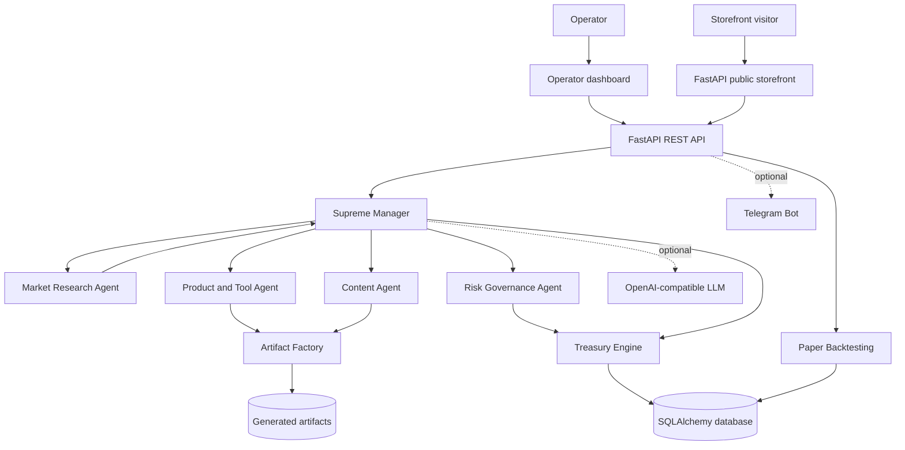

# NovaCraft Studio — Autonomous Multi-Agent Business & Treasury Simulator

[](https://github.com/Shivanshpoop/ai-survivor/actions/workflows/ci.yml)


NovaCraft Studio is an experimental **multi-agent business orchestration and treasury simulator** built with Python, FastAPI, SQLAlchemy, and an optional OpenAI-compatible LLM. It explores how specialized agents can research opportunities, propose digital products, manage virtual budgets, record ledger activity, and operate under capital-preservation guardrails.

> **Simulation and safety notice:** This repository is an educational prototype, not a production financial platform. Keep `PAPER_MODE_ONLY=true` while developing and testing. Paper results are simulated and are not revenue. Do not connect real funds, payment credentials, or brokerage accounts to an unreviewed deployment. The storefront's UPI flow uses operator approval of submitted references; it is not an automatic payment-provider verification integration.

## Highlights

- **Specialized agent swarm:** market research, product/tool creation, content generation, and risk governance coordinated by a supreme manager.
- **Treasury engine:** virtual capital allocation, agent balances, ledger entries, expense/revenue recording, audit logs, emergency reserve protection, and survival-state checks.
- **Artifact factory:** generates standalone browser deliverables and supports paper-strategy backtests.
- **Storefront and operator UI:** a public product catalogue plus an operator dashboard served from the `static/` directory.
- **Optional integrations:** an OpenAI-compatible chat-completions endpoint and Telegram notifications, both configured through environment variables.
- **API-first design:** FastAPI routes expose agent, treasury, simulation, storefront, worker-task, and telemetry operations.

## System architecture



### Request and execution flow

1. The FastAPI application initializes database tables and the treasury during startup.
2. The supreme manager coordinates specialized agents during an autonomous simulation cycle.
3. Agents evaluate opportunities and may create deliverable artifacts or paper backtests.
4. Treasury operations enforce budget, allocation, and emergency-reserve rules.
5. Ledger and audit records provide an inspectable history of simulated activity.
6. Optional LLM and Telegram integrations are inactive unless configured.

## Repository layout

```text
.
├── app/
│   ├── agents/             # Supreme manager and specialized agents
│   ├── api/                # FastAPI route definitions and request models
│   ├── core/               # Settings, database, and authentication
│   ├── execution/          # Artifact generation and paper backtesting
│   ├── models/             # SQLAlchemy domain models
│   ├── services/           # Treasury engine and Telegram notifier
│   └── main.py             # FastAPI application and lifespan
├── static/                 # Storefront and operator dashboard
├── artifacts/              # Generated deliverables (runtime output)
├── tests/                  # Automated tests
├── .env.example            # Generic configuration template
├── requirements.txt
└── README.md
```

## Local setup

### Requirements

- Python 3.11 or newer
- Git
- Windows PowerShell, macOS Terminal, or Linux shell

### 1. Clone and enter the repository

```bash
git clone https://github.com/Shivanshpoop/ai-survivor.git
cd ai-survivor
```

### 2. Create and activate a virtual environment

**Windows PowerShell**
```powershell
python -m venv .venv
.venv\Scripts\Activate.ps1
```

**macOS / Linux**
```bash
python3 -m venv .venv
source .venv/bin/activate
```

### 3. Install dependencies and configure the environment

```bash
python -m pip install --upgrade pip
pip install -r requirements.txt
```

Copy the template and edit the values locally:

**Windows PowerShell**
```powershell
Copy-Item .env.example .env
```

**macOS / Linux**
```bash
cp .env.example .env
```

Set a unique, long `ADMIN_TOKEN`. Keep `.env` private and never commit it. Optional LLM and Telegram integrations can remain blank.

### 4. Start the application

```bash
uvicorn app.main:app --reload
```

- Public storefront: http://127.0.0.1:8000/
- Store catalogue API: http://127.0.0.1:8000/api/store/catalog
- Health check: http://127.0.0.1:8000/health
- Operator dashboard: the path configured by `HIDDEN_ADMIN_PATH` (default: `/ops-control-change-this`)

The operator dashboard path is an obscurity feature, **not authentication**. Protect the deployment at the network/application layer and use the bearer token for protected API routes.

## Environment variables

All supported settings are listed in `.env.example`. Values below are generic placeholders; supply your own secrets only in your local, untracked `.env`.

| Variable | Purpose | Example / default |
|---|---|---|
| `APP_NAME` | FastAPI application title | `NovaCraft Studio — Digital Tools, Services & Merch` |
| `ENVIRONMENT` | Runtime environment label | `development` |
| `DATABASE_URL` | SQLAlchemy database connection URL | `sqlite:///./ai_survivor_p1.db` |
| `ADMIN_TOKEN` | Bearer token for protected operator API routes | `replace-with-a-long-random-secret` |
| `HIDDEN_ADMIN_PATH` | Operator dashboard URL path | `/ops-control-change-this` |
| `INITIAL_CAPITAL` | Starting virtual treasury balance in INR | `5000.0` |
| `EMERGENCY_RESERVE_RATIO` | Fraction of capital protected as reserve | `0.20` |
| `MAX_SINGLE_ALLOCATION_RATIO` | Maximum single-agent concentration ratio | `0.30` |
| `PAPER_MODE_ONLY` | Force revenue entries to remain simulated | `true` |
| `LLM_API_KEY` | Optional LLM provider API key | blank |
| `LLM_BASE_URL` | OpenAI-compatible API base URL | `https://generativelanguage.googleapis.com/v1beta/openai` |
| `LLM_MODEL` | Model name sent to the provider | `gemini-2.5-flash` |
| `TELEGRAM_BOT_TOKEN` | Optional Telegram bot token | blank |
| `TELEGRAM_CHAT_ID` | Optional Telegram destination chat ID | blank |
| `AUTO_CYCLE_INTERVAL_SECONDS` | Configured autonomy interval | `30` |
| `FAMPAY_UPI_ID` | Storefront UPI payee identifier placeholder | `YOUR_DEMO_UPI_ID` |
| `FAMPAY_PAYEE_NAME` | Storefront payee display name | `Example Demo Store` |
| `BUSINESS_EMAIL` | Storefront contact address | `contact@example.com` |
| `PUBLIC_STORE_URL` | Public base URL used in notifications and links | `http://127.0.0.1:8000` |

## API endpoint overview

Protected endpoints require an `Authorization: Bearer <ADMIN_TOKEN>` header unless marked **Public**. The exact route definitions are in `app/api/routes.py`.

| Method | Endpoint | Access | Purpose |
|---|---|---|---|
| `GET` | `/` | Public | Serve the storefront |
| `GET` | `/health` | Public | Health and autonomy status |
| `GET` | `/api/store/catalog` | Public | List generated storefront products |
| `POST` | `/api/store/claim-upi` | Public | Submit an order/payment reference for operator review |
| `GET` | `/api/store/order-status/{order_id}` | Public | Check order status |
| `GET` | `/api/store/fulfill/{download_token}` | Public token link | Download a fulfilled order |
| `GET` | `/api/state` | Admin | Treasury, agents, ledger, opportunities, artifacts, and telemetry |
| `POST` | `/api/cycle/run` | Admin | Run one autonomous simulation cycle |
| `POST` | `/api/agents` | Admin | Create an agent and optionally assign its initial budget |
| `POST` | `/api/agents/{agent_id}/allocate` | Admin | Allocate additional treasury funds |
| `POST` | `/api/agents/{agent_id}/suspend` | Admin | Suspend an agent and recall its remaining balance |
| `POST` | `/api/ledger/expense` | Admin | Record an agent expense |
| `POST` | `/api/ledger/revenue` | Admin | Record paper or verified revenue |
| `POST` | `/api/autonomy/toggle` | Admin | Toggle autonomous execution |
| `POST` | `/api/system/backup` | Admin | Create a local SQLite backup |
| `GET` | `/api/artifacts/download/{file_name}` | Admin | Download a generated artifact |
| `GET` | `/api/worker/tasks` | Admin | Fetch pending worker tasks |
| `POST` | `/api/worker/tasks/{task_id}/complete` | Admin | Submit a worker task result |
| `GET` | `/api/telegram/setup` | Integration | Register Telegram commands and webhook |
| `POST` | `/api/telegram/webhook` | Telegram webhook | Receive Telegram updates |
| `GET` | `/api/orders/{order_id}/approve-upi` | Token query | Operator approval flow for a submitted UPI reference |

Interactive API docs are available at http://127.0.0.1:8000/docs while the application is running.

## Tests and CI

Run the test suite locally:

```bash
pip install pytest
python -c "import app.main"
pytest -q
```

GitHub Actions runs the same import check and test suite on every push and pull request using Python 3.11. The treasury tests use an isolated in-memory SQLite database and do not require external credentials or network services.

## Security and operational notes

- Never commit `.env`, API keys, Telegram tokens, chat IDs, personal email addresses, payment identifiers, database files, or customer data.
- Keep `PAPER_MODE_ONLY=true` for local development and CI. Simulated P&L is not cash and must not be presented as verified revenue.
- The current UPI order workflow collects a submitted reference and relies on an operator approval action. It is not a payment gateway and does not independently verify settlement.
- The dashboard URL is not a security boundary. Protected API routes use bearer-token authentication; deploy behind HTTPS and a properly configured reverse proxy.
- Review the background autonomy loop, webhook authorization, payment approval flow, database migrations, backups, and rate limiting before any public or production deployment.
- Do not use this prototype for investment advice, live trading, custody, or unattended financial transactions.

## Portfolio summary

NovaCraft Studio demonstrates applied backend engineering, multi-agent orchestration, financial ledger design, API development, and risk-aware simulation. It is an evolving open-source project; the repository's CI status reflects automated import and unit-test checks, not a production certification.

## License

No license file is currently declared. Add an explicit open-source license before inviting reuse or external contributions.
